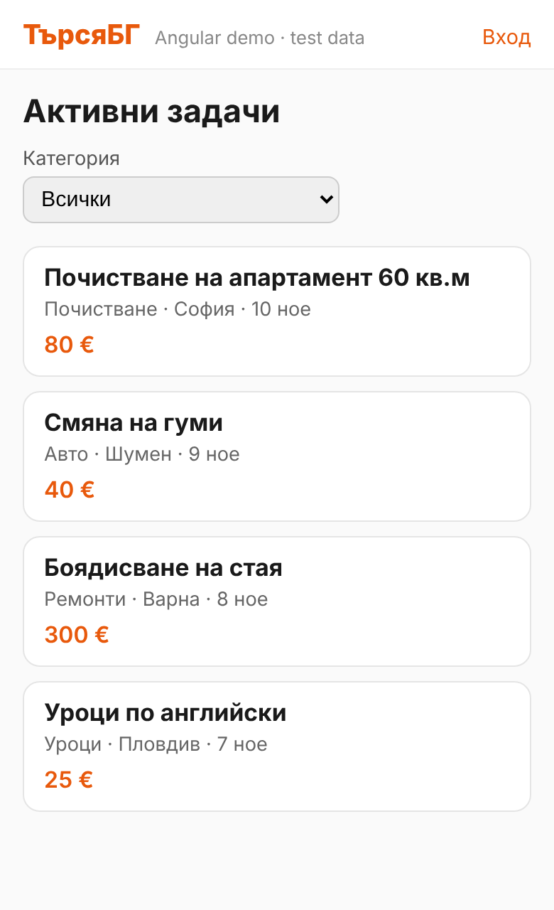
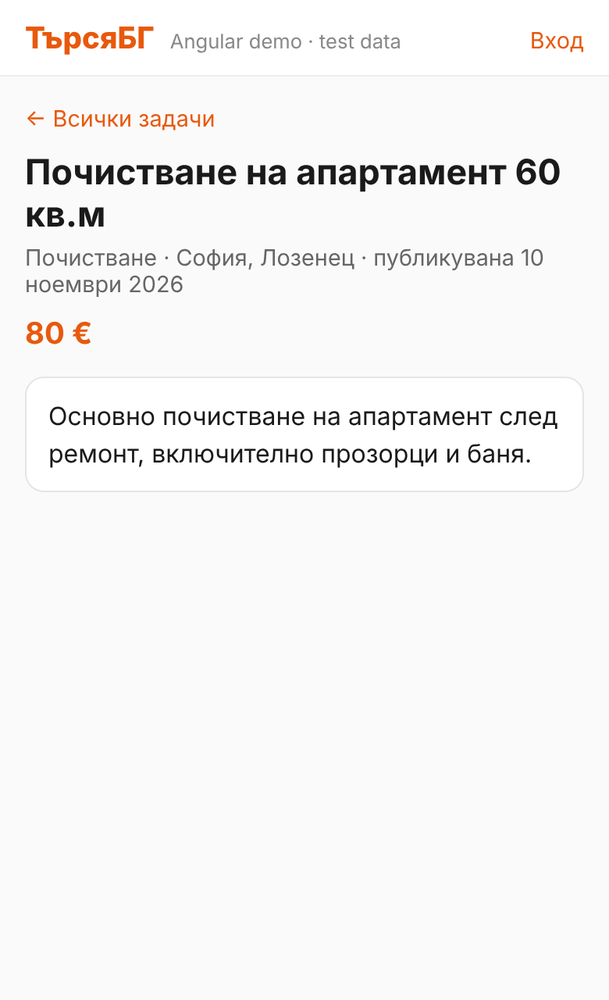
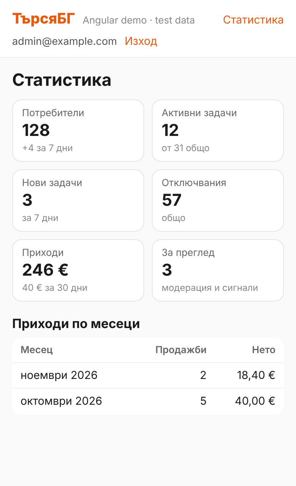

# tursya-angular

A small Angular app I built to learn Angular on real data. It reads job posts ("tasks") from the
Supabase backend of [tursya.bg](https://tursya.bg), a Bulgarian marketplace for local services that I build.

The main site is written in React (TanStack Start). This project is **separate**: it does not change the site
or its database, and it only connects to the Supabase **test** project.

<p>
  
  
  
</p>

## Features

- **Task list** (`/`): newest active tasks, filter by category.
- **Task detail** (`/task/:id`): full description; "not found" for hidden, deleted or broken links.
- **Sign-in** (`/login`): email and password through the Supabase Auth REST API.
- **Admin statistics** (`/admin`): user, task and revenue numbers, for staff only.

## Angular concepts used

| Concept | Where |
|---|---|
| Standalone components, new control flow (`@if`, `@for`, `@switch`, `@let`) | every page |
| Signals, `computed`, `toSignal` / `toObservable` | `TaskList`, `TaskDetail`, `AuthService` |
| RxJS: `switchMap` (cancel the old request when the filter changes), `forkJoin` (two requests in parallel) | `TaskList`, `AdminService` |
| Services and dependency injection (`inject()`) | `TasksService`, `AuthService`, `AdminService` |
| `HttpClient` and a functional HTTP interceptor (API key, bearer token) | `core/supabase.interceptor.ts` |
| Routing, route parameters bound to component inputs (`withComponentInputBinding`) | `app.routes.ts`, `TaskDetail` |
| Route guard (`CanActivateFn`) | `auth/signed-in.guard.ts` |
| Reactive forms with validators | `auth/login` |
| Custom pipe, built-in `date` / `currency` pipes with the Bulgarian locale | `category-name.pipe.ts`, `app.config.ts` |

## Security notes

- Only the Supabase **publishable** key is used in the browser. The test project's URL and key live in
  `src/environments/environment.development.ts`, which is in `.gitignore` and never committed.
- The route guard only improves the experience. The real check is in the database: the admin functions
  refuse anyone who is not staff, and Row Level Security hides non-public tasks.
- The access token is sent only to the Supabase project, never to other sites.
- After sign-in the app only follows return paths inside the app (no open redirect).
- No token refresh: after one hour you sign in again. That is enough for a demo.

## Tests

| Type | Tool | Count | Command |
|---|---|---|---|
| Unit and component tests | Vitest, `TestBed`, `HttpTestingController` | 24 | `npm test` |
| End-to-end tests | Playwright, Supabase API replaced with fixed answers (`e2e/mock-api.ts`) | 6 | `npm run e2e` |

The end-to-end tests need no network, accounts or secrets, so they always see the same data.

## Run locally

Requirements: Node.js 22.22.3+ or 24.15+.

```bash
npm install
```

Create `src/environments/environment.development.ts` with your own Supabase project:

```ts
export const environment = {
  supabaseUrl: 'https://<your-project>.supabase.co',
  supabaseKey: '<your publishable key>',
};
```

```bash
npm start      # http://localhost:4200
npm test       # unit tests
npm run e2e    # Playwright tests (needs: npx playwright install chromium)
```

## Built with

Angular 22, TypeScript, RxJS, Vitest, Playwright, Supabase (REST and Auth).
Developed step by step with an AI coding assistant (Claude); I ran, checked and tested every step.
